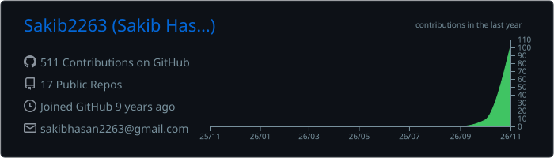
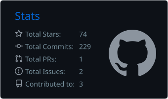
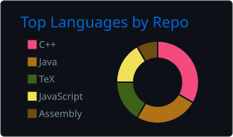

<a href="https://sakib-hasan.netlify.app"></a>

<p align="center">
  <a href="https://readme-typing-svg.demolab.com"></a>
</p>

<p align="center">
  <a href="https://sakib-hasan.netlify.app"></a>
  <a href="https://sakib-hasan.netlify.app/play/"></a>
  <a href="https://www.linkedin.com/in/sakibhasancsedu/"></a>
  <a href="mailto:sakibhasan2263@gmail.com"></a>
</p>

---

### 🎮 Player stats

| 📈 Revenue growth | 🤝 Partner revenue | 🏢 Publishers | 💸 Monthly UA spend | 🕹️ Titles scaled |
|:---:|:---:|:---:|:---:|:---:|
| **+500%** at Borofpani | **$3M+** | **20+** onboarded | **$500K+** managed | **50+** |

```yaml
player: Sakib Hasan            # not the cricketer, not the actor 🙂
class: Growth & Partnership Manager @ Borofpani (Softograph Limited)
base: Dhaka, Bangladesh  (GMT+6, works remote)
skills: [User Acquisition, Ad Mediation (MAX · AdMob · LevelPlay), Partnerships, Game Design, Data Analytics]
side_quests: [Hivemind multi-model AI, solo web games, gamification]
education: BSc CSE, University of Dhaka
```

### 🚀 Featured builds

| Project | What it is | Stack |
|---|---|---|
| 🧠 **[Hivemind](https://github.com/Sakib2263/hivemind-public)** | Claude leads, free models (GLM, DeepSeek, Gemini) build through a local relay, with cross-vendor review and quality gates | Python · Bash · AI agents |
| 🏰 **[Cottage Guard / Holdfast 3D](https://sakib-hasan.netlify.app/play/)** | Pastel 3D tower defense, built solo | three.js · Android |
| ⚙️ **[Windup: Gear Connect](https://sakib-hasan.netlify.app/play/)** | Calm gear-connect logic puzzle, built solo | three.js · Android |
| 🌐 **[sakib-portfolio](https://github.com/Sakib2263/sakib-portfolio)** | This portfolio: 4 themes, 3D hero, offline assistant "Kibo", Game Zone | Vite · three.js · GSAP |
| 🌿 **[Plant Disease Classification](https://github.com/Sakib2263/Plant-disease-classification-Using-leaf-image)** | Leaf-image disease classifier | TensorFlow · Keras |
| ✈️ **[AirStrike Defense](https://github.com/Sakib2263/AirStrike-Defense)** | Classic defense game from scratch | C++ · iGraphics |

### 🛠️ Toolbox

<p>
  
</p>

`Google Ads` `Meta Ads` `TikTok Ads` `AppLovin MAX` `AdMob` `Unity LevelPlay` `AppsFlyer` `Adjust` `Firebase` `Tableau` `ASO`

### 📊 GitHub activity

<p align="center">
  
</p>
<p align="center">
  
  
</p>
<p align="center">
  
</p>

<p align="center">
  <picture>
    <source media="(prefers-color-scheme: dark)" srcset="https://raw.githubusercontent.com/Sakib2263/Sakib2263/output/snake-dark.svg">
    
  </picture>
</p>

### ✍️ Latest thinking

- [Mobile Gaming Playbook Resets Every 6-7 Years: We're Due](https://sakib-hasan.netlify.app/insights/mobile-gaming-playbook-resets/)
- [The Evolution of Hybrid-casual Mobile Gaming](https://sakib-hasan.netlify.app/insights/evolution-of-hybrid-casual/)
- [Deep-casual vs. Hybrid-casual: Navigating the Nuance](https://sakib-hasan.netlify.app/insights/deep-casual-vs-hybrid-casual/)

<p align="center"><sub>Open to UA / monetization consulting, game and web builds, and fixing AI-generated projects · <a href="https://sakib-hasan.netlify.app/#contact">get in touch</a></sub></p>
